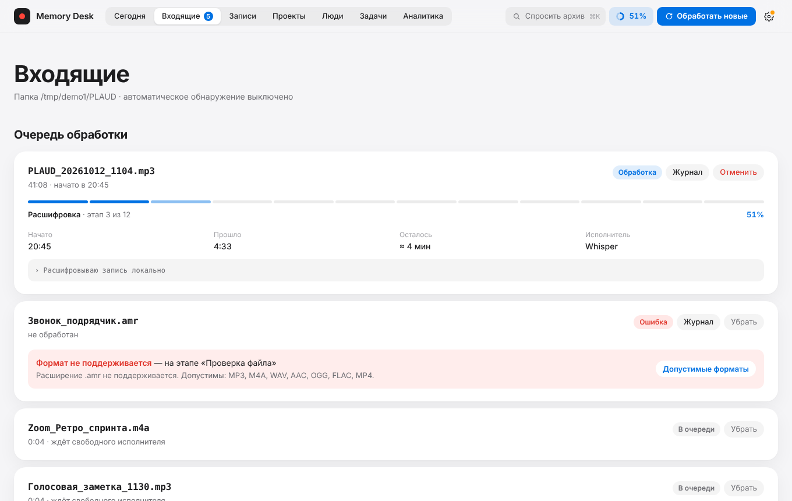

# Memory Desk

Локальный AI-кабинет встреч для macOS. Принимает аудио с PLAUD и других рекордеров, расшифровывает его, выделяет решения, задачи, риски и открытые вопросы, складывает заметки в Obsidian и отвечает на вопросы по всему архиву записей. **Аудио, стенограммы и заметки не покидают компьютер**: расшифровка, анализ и поиск выполняются локальными моделями.


> Все изображения в этом репозитории сделаны на вымышленных данных из `tests/make_fixture.py`.

## Зачем это сделано

Я купил рекордер PLAUD — устройство классное, но хотелось сделать своё: **локально, на MacBook, без подписок и облачных сервисов**. Идея простая: вы просто кидаете файл записи в папку и получаете примерно то же самое — расшифровку, краткое содержание, решения, задачи, риски и вопросы, — но бесплатно и так, что записи никуда не уходят с вашего компьютера. Memory Desk — независимый проект и никак не связан с PLAUD; он работает с аудиофайлами любых рекордеров.

## Что это даёт

- **Запись → готовая заметка без ручной работы.** Положили файл в папку — получили стенограмму с таймкодами, заголовок, краткое содержание, решения, задачи (с ответственным и сроком), риски и вопросы.
- **Единый рабочий кабинет** вместо россыпи заметок: что решили, что в работе, что просрочено, что осталось без проекта.
- **Вопросы по архиву** на обычном языке. Ответ строится только по вашим записям и содержит источники с таймкодами. Если подтверждения нет — чат так и скажет. Вопросы вида «что сделано по проекту X за месяц» дают сводку по всем записям периода.
- **Материалы по запросу.** Протокол встречи, карта (mind map) и презентация `.pptx` по записи, проекту или человеку — собираются из извлечённых фактов и работают даже без модели.
- **Obsidian остаётся читаемым архивом.** Заметки и стенограммы — обычные Markdown-файлы; SQLite хранит рабочие статусы, Qdrant — смысловой поиск.
- **Полностью локально.** Нет облачных API, нет учётных записей, сервер слушает только `127.0.0.1`.

Подробный перечень возможностей по экранам — в [docs/FEATURES.md](docs/FEATURES.md), устройство системы — в [docs/ARCHITECTURE.md](docs/ARCHITECTURE.md).

## Как это работает

```text
PLAUD / рекордер ─► папка записей ─► MLX Whisper ─► Ollama (qwen3:4b) ─► заметка + стенограмма в Obsidian
                                       стенограмма     решения, задачи,          │
                                       с таймкодами    риски, вопросы            ▼
                                                                    SQLite (статусы, связи)
                                                                    Qdrant (смысловой поиск)
                                                                            │
                                                          FastAPI :8502 ◄───┘───► React-интерфейс
```

| Этап | Чем выполняется |
| --- | --- |
| Расшифровка | `mlx-whisper`, модель `whisper-large-v3-turbo`, фильтр «галлюцинаций» на музыке и шуме |
| Анализ и чат | Ollama, `qwen3:4b` (собственный экземпляр на `127.0.0.1:11435`) |
| Векторный поиск | `sentence-transformers/paraphrase-multilingual-MiniLM-L12-v2` + Qdrant Local |
| Сервер | FastAPI + SSE (прогресс обработки без перезагрузки страницы) |
| Интерфейс | React 18 + TypeScript + Vite, светлая и тёмная темы |
| Хранилище | SQLite (WAL), Obsidian-заметки, Qdrant Local |

## Требования

- Mac с **Apple Silicon** (M1 и новее), macOS 13 или новее.
- **16 ГБ** оперативной памяти рекомендуется; при меньшем объёме установщик предупредит, а длинные записи могут обрабатываться медленно.
- Около **12 ГБ** свободного места: модели Whisper, Ollama и эмбеддингов, окружение Python.
- Интернет — только при установке (пакеты и модели). После установки кабинет работает офлайн.

Intel-Mac не поддерживается: MLX Whisper работает только на Apple Silicon.

## Установка

```bash
git clone <адрес-репозитория> memory-desk
cd memory-desk
./install.command
```

Если проект скачан архивом (ZIP), macOS помечает файлы карантином — снимите отметку перед запуском:

```bash
xattr -dr com.apple.quarantine .
chmod +x *.command meeting-assistant meetings-process
./install.command
```

Установщик (`install.command`) последовательно:

1. проверяет систему: Apple Silicon, версию macOS, свободное место, объём памяти;
2. ставит через Homebrew `python@3.12`, `ffmpeg` и `ollama`, если их нет;
3. создаёт окружение `.venv` и устанавливает пакеты из `requirements.txt`;
4. создаёт рабочие папки (`logs`, `runtime`, `webui/data`, `work`) и снимает карантин;
5. запускает собственный экземпляр Ollama и загружает `qwen3:4b` в `ollama-models/` внутри проекта;
6. заранее скачивает модель эмбеддингов и модель Whisper в `huggingface-cache/`, чтобы дальше работать офлайн;
7. выводит итог и открывает кабинет.

Повторный запуск безопасен: готовые шаги пропускаются, пользовательские данные не затрагиваются.

| Ключ | Действие |
| --- | --- |
| `--check` | только проверить состояние, ничего не менять |
| `--skip-models` | не скачивать модели (для повторной настройки без сети) |
| `--no-open` | не открывать кабинет по завершении |
| `--help` | справка |

Журнал установки: `logs/install.log`.

После установки откройте шестерёнку → «Настройки» и выберите папку записей, папку Obsidian и срок хранения аудио.

> **Установщик пока проверен только на заглушках** (см. [«Что проверено»](#что-проверено)): порядок шагов, идемпотентность, отказ на Intel и при нехватке места покрыты тестами `tests/test_installer.py`, но на «чистом» Mac с реальными загрузками он ещё не запускался. Если что-то пошло не так, пришлите `logs/install.log`.

## Ежедневная работа

1. Положите аудиофайлы в выбранную папку записей (или включите автообработку в настройках).
2. Запустите `start.command` — откроется кабинет на `http://127.0.0.1:8502`.
3. Нажмите «Обработать новые». Прогресс (12 этапов, процент, оставшееся время) идёт в реальном времени.
4. Разберите «Входящие»: назначьте проект, тип и участников, подтвердите найденные решения и задачи, опубликуйте запись в Obsidian.
5. Задавайте вопросы по архиву: `⌘K`.

Поддерживаются MP3, WAV, M4A, AAC, FLAC, OGG, MP4. Дубликаты определяются по SHA-256. При сбое стенограмма и промежуточные результаты сохраняются, обработка продолжится с готового этапа.

## Экраны

| | |
| --- | --- |
|  **Входящие** — очередь обработки |  **Запись** — плеер, стенограмма, решения и задачи |
|  **Задачи** — реестр и черновики |  **Аналитика** — динамика и сроки |
|  **Проекты** — кнопки «Презентация» и «Карта» |  **Спросить архив** — сводка по проекту за период (на снимке Ollama отключена: «режим без модели») |
|  **Календарь** — события и записи за любой диапазон |  **Дерево решений** — действующие и заменённые |
|  **Протокол** — по записи, с правкой и сохранением в Obsidian |  **Презентация** — слайд «Главное» из `.pptx` |

## Данные и конфиденциальность

Все данные лежат внутри папки проекта и в `~/Library/Application Support/MemoryDesk/`:

| Данные | Путь |
| --- | --- |
| Настройки | `~/Library/Application Support/MemoryDesk/config.json` |
| SQLite | `webui/data/meetings.db` (если каталога нет — `data/`) |
| Qdrant | `webui/data/qdrant` |
| Резервные копии базы | `webui/data/backups` |
| Журналы | `logs/` |
| Промежуточные результаты | `work/<имя-записи>` |
| Модели | `ollama-models/`, `huggingface-cache/` |

Папка записей и хранилище Obsidian выбираются в настройках и могут находиться где угодно.

- Сервер слушает только `127.0.0.1`, принимает запросы только с адресом `127.0.0.1`/`localhost` и требует заголовок `X-Memory-Desk` для любых изменяющих запросов: произвольный сайт в браузере не сможет управлять кабинетом.
- Отпечатки голосов (необязательная функция «По голосу») — **биометрические данные**. Они хранятся только локально, добавляются действием человека с подтверждением согласия и удаляются в разделе «Люди».
- `.gitignore` исключает аудио, стенограммы, базы, поисковый индекс, модели, журналы, резервные копии и локальные настройки. **Не публикуйте свои данные**: репозиторий содержит только код, а тестовые данные вымышлены и создаются скриптом.

## Разработка

```bash
# окружение для разработки и тестов
python3.12 -m venv .venv && .venv/bin/pip install -r requirements.txt pytest httpx

# сервер (порт 8502)
.venv/bin/python -m memory_desk

# интерфейс с горячей перезагрузкой (порт 5173, проксирует /api на 8502)
cd frontend && npm install && npm run dev

# сборка интерфейса в memory_desk/web
cd frontend && npm run build

# тесты (модель эмбеддингов подменяется заглушкой)
MEMORY_DESK_FAKE_EMBED=1 .venv/bin/python -m pytest -q tests
```

Тестовые наборы данных:

```bash
python tests/make_fixture.py /tmp/demo     # небольшой «человеческий» набор
python tests/make_stress.py  /tmp/stress   # ~55 записей с крайними случаями
```

Обе команды печатают `export`-строки с путями — выполните их и запустите `python -m memory_desk`, чтобы посмотреть кабинет на вымышленных данных.

Структура репозитория:

```text
memory_desk/       сервер: API, очередь, поиск, сводки, интеграции
frontend/          исходники интерфейса (React + Vite)
memory_desk/web/   собранный интерфейс (Node.js для работы не нужен)
meetings_process.py   конвейер обработки записи (CLI)
tests/             тесты сервера и установщика, генераторы тестовых данных
docs/              описание возможностей, архитектура, статус реализации
install.command    установщик; start.command — запуск кабинета
```

## Что проверено

- **Автоматически** (`pytest`): API и защита, фильтры и поиск, карточка записи, публикация, задачи и решения, аналитика, сводки в чате, протокол, карта и презентация, дерево решений, календарь с диапазоном, «главное к встрече», ограничения ввода, переиндексация, устойчивость заметок к «враждебным» правкам, подменённые EventKit и кодировщик голосов, сценарии установщика на заглушках.
- **В браузере** (Chromium, вымышленные данные): все экраны в светлой и тёмной теме на трёх ширинах, нагрузочный набор из ~55 записей без ошибок JavaScript и без ответов 500.

**Не проверено на реальном железе** (среда разработки без Apple Silicon): расшифровка MLX Whisper и анализ Ollama через новый интерфейс, качество ответов и сводок `qwen3:4b`, загрузка настоящей модели эмбеддингов, чтение Календаря и Напоминаний через EventKit, модель голосов ECAPA и подобранный порог сходства, работа фильтра Whisper на реальной музыке и шуме, установка на «чистый» Mac. Первый запуск стоит пройти на одном коротком файле.

Полный список ограничений и планов — в [docs/STATUS.md](docs/STATUS.md).

## Лицензия

[MIT](LICENSE).
