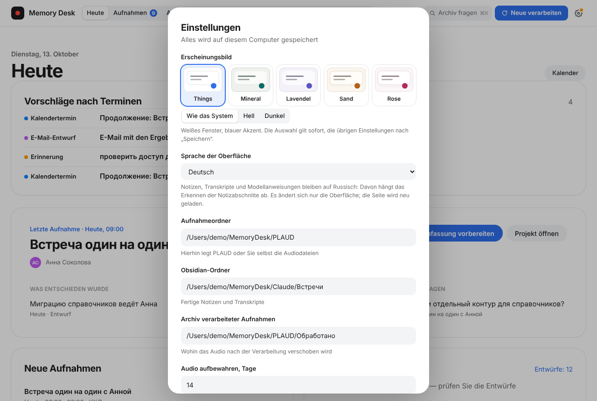
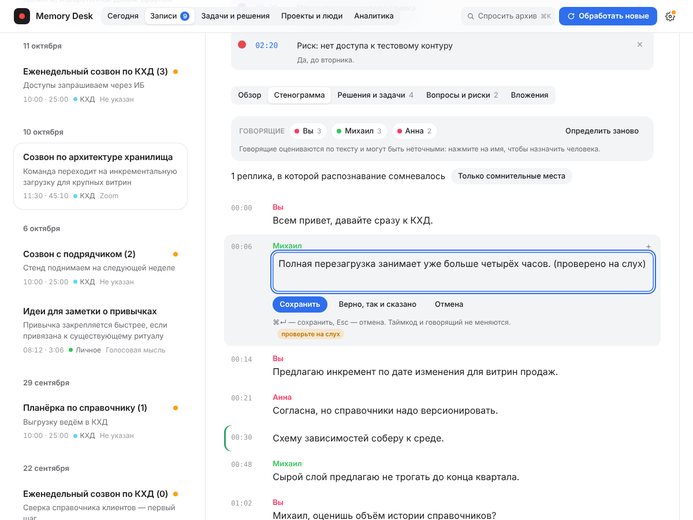
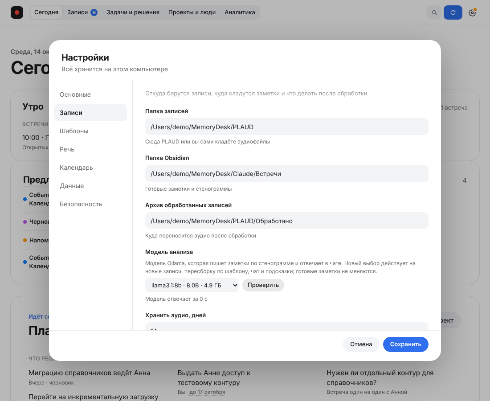
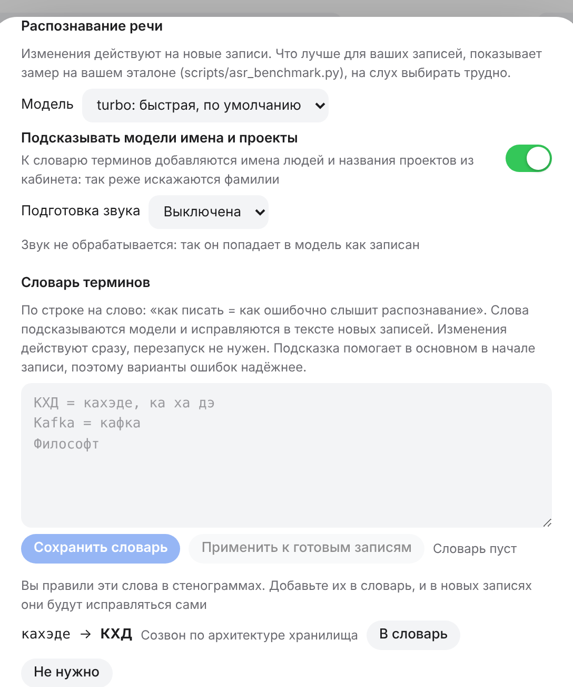
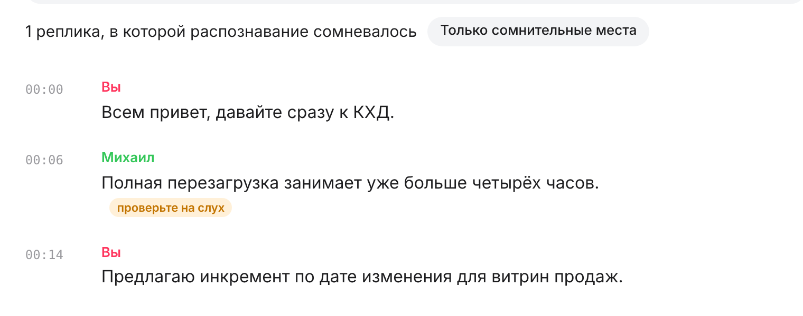

# Функциональные возможности Memory Desk

Документ описывает, что умеет система сейчас. Что ещё не сделано и что не проверено на реальном железе — в [STATUS.md](STATUS.md).

## 1. Обработка записей

**Приём.** Кабинет следит за выбранной папкой записей. Форматы: MP3, WAV, M4A, AAC, FLAC, OGG, MP4. Неподдерживаемые файлы показываются в очереди с объяснением. Повторный файл определяется по SHA-256 и не создаёт вторую встречу.

**Конвейер из 12 этапов** с весами: проверка файла, подготовка аудио, расшифровка (самый тяжёлый этап), определение говорящих, анализ, создание заметки, обновление базы, индексация, архивирование, проверка, публикация, готово. В интерфейсе видны процент по весам этапов, прошедшее и оставшееся время, журнал; задачу можно отменить, повторить или скрыть. Состояние приходит по SSE — страница не перезагружается, перезагрузка браузера не сбрасывает задачу.

**Расшифровка.** MLX Whisper (`whisper-large-v3-turbo`) на Apple Silicon. Фильтр «галлюцинаций» убирает выдуманные и зацикленные реплики на музыке и шуме (коэффициент сжатия, `no_speech`, типовые фразы, схлопывание повторов) и пишет в журнал, сколько реплик убрано.

**Экспорт документов.** Протокол, карту и ответ чата можно скачать как PDF, Word (.docx), HTML или Markdown. PDF и Word — с настоящими заголовками, таблицами и списками, номерами страниц; HTML открывается без интернета. Правки, сделанные в окне материала, попадают в файл.

**Закладки.** Кнопка «Закладка» или клавиша B ставят отметку на текущем месте записи; у закладки комментарий и цвет, по клику — переход к месту. Хранятся в заметке Obsidian разделом «Закладки», поэтому переживают потерю базы, переиндексацию и пересборку заметки; попадают в поиск, подготовку к встрече и протокол.

**Подсказки вопросов.** Под последним ответом чата показываются 2–3 вопроса, которые можно задать дальше (по открытым вопросам записей, решениям, задачам и рискам; без записей — общие). Клик отправляет вопрос; заданные уже не повторяются.

**Сохранение ответа чата.** Под ответом с источниками кнопка «Сохранить в Obsidian» кладёт заметку в `Ответы/`: вопрос, ответ, источники с внутренними ссылками на записи, таймкодами и цитатами. Повторное сохранение дублей не создаёт и не стирает ваши правки в заметке.

**Шаблоны заметки.** Десять готовых шаблонов: пять общих («Совещание с решениями», «Планёрка», «Встреча один на один», «Интервью», «Лекция или обучение») и пять фокусных, которые раньше были «взглядами» («Только решения», «Задачи по людям», «Вопросы к заказчику», «Риски», «Для руководителя на 5 строк»). Шаблон задаёт разделы и инструкции модели; свои шаблоны лежат в папке данных и составляются по описанию. Шаблон выбирается для файла во «Входящих» (по умолчанию из настроек) или для готовой записи кнопкой «Пересобрать по другому»: подтверждённые задачи и решения сохраняются, прежняя заметка остаётся в копиях. Разделы «Задачи» и «Решения» пишутся в формате, который читает кабинет, любые другие попадают в поиск и чат. Если малая модель не справилась с шаблоном, заметка составляется стандартным. Разделы «Взгляд: …», добавленные в прежних версиях, остаются в заметках как обычные разделы и переживают пересборку.

**Словарь терминов.** Слова, которые Whisper путает (аббревиатуры, названия, имена), записываются в настройках по строке: «КХД = кахэде, ка ха дэ». Слова подсказываются модели и исправляются в стенограмме с учётом границ слов и регистра; правка действует на следующую запись без перезапуска, а «Применить к готовым записям» исправляет уже готовые стенограммы. Подсказка влияет в основном на начало записи, поэтому надёжнее перечислять и варианты ошибок.

**Автообработка и уведомление.** Включённая автообработка берёт новый файл в работу через 10 секунд после появления в папке; по окончании приходит уведомление macOS «Запись готова, проверьте N задач».

**Анализ.** Локальная Ollama (`qwen3:4b`) формирует заголовок, краткое содержание, темы, решения, задачи (ответственный, срок), риски и открытые вопросы. Длинные записи анализируются кусками примерно по 6000 символов, результаты объединяются. Ответы модели разбираются устойчиво: повтор запроса, JSON-режим, разбор обрезанных и «грязных» ответов.

**Отказоустойчивость.** Промежуточные результаты хранятся в `work/<имя-записи>`; при сбое обработка продолжается с готового этапа. Ошибки показываются человеческим языком.

**Хранение аудио.** После проверки созданных файлов аудио переносится в архив и удаляется по сроку хранения из настроек.

**Результат.** Заметка и отдельная стенограмма в Obsidian (стабильный ID встречи — переименование заметки не ломает связи), метаданные в SQLite, фрагменты в Qdrant.

## 2. Экраны

### Сегодня
Следующая встреча (из Календаря macOS или ICS-файла/ссылки) либо последняя запись. Для предстоящей встречи — «подготовка к встрече»: что решали и что осталось открытым по связанным записям. Три колонки: «Что решили», «Открытые задачи», «Открытые вопросы». Новые записи, задачи, решения за неделю, записи без проекта, строка текущей обработки. **Срок задачи** ставится прямо на месте: быстрые кнопки «Сегодня / Завтра / Через неделю», выбор даты, «Без срока». «Подготовка к встрече» начинается с абзаца **«Главное к встрече»**: локальная модель за одно-два предложения называет самое важное (просроченное, нерешённые вопросы, последние решения) по тезисам ниже; тезисы показываются сразу, абзац уточняется модели, а без Ollama остаётся строка из цифр. Решения, отмеченные как заменённые, в «Сегодня» и в подготовке не показываются.

### Записи
Вверху экрана блок «Новые и в обработке» (виден, пока есть файлы): очередь с 12 сегментами, шаблоном для каждого файла, журналом, отменой, повтором и скрытием. Записи, требующие проверки: выбор проекта и типа, участников, публикация в Obsidian; «Опубликовано» означает проверенную запись с проектом и типом.

Фильтры (проект, человек, тип, статус, период) и поиск по тексту; состояние сохраняется в адресе страницы. Карточка записи:
- настоящий аудиоплеер с перемоткой по Range-запросам и формой волны;
- стенограмма с подсветкой текущей реплики и переходом по таймкодам;
- решения, задачи, вопросы, риски; правка названия и краткого содержания;
- участники, публикация, архивирование с отменой, ссылка в Obsidian;
- события Календаря рядом со временем записи и привязка записи к событию;
- **«Протокол»** и **«Карта»** — материалы по этой записи (см. раздел «Материалы по запросу»).

**Говорящие.** Панель над стенограммой. «Определить говорящих» оценивает по тексту, кто говорит («Спикер 1», «Спикер 2»), для любой готовой записи. Человека можно назначить на все реплики говорящего или на одну реплику; новый человек создаётся прямо в окне выбора; слияние говорящих — переименованием. Метки хранятся в стенограмме Obsidian в формате `**Имя:** реплика`.

**По голосу (необязательно).** Делит запись по звуку (локальная модель SpeechBrain ECAPA) и узнаёт знакомых людей. «Запомнить голос» добавляет отпечаток в профиль человека — с подтверждением согласия. Узнавание требует уверенного сходства и заметного отрыва от второго кандидата; сомнительные голоса остаются «Спикер N». Если реплика почти одинаково похожа на двух говорящих, рядом с ней появляется отметка «наложение голосов?»: метка говорящего не меняется, речь по голосам не разделяется, отмечается не больше десятой части реплик.

### Проекты и люди
Один пункт верхней панели с переключателем «Проекты | Люди» внутри.

**Проекты.** Карточка: цель, записи, открытые задачи и вопросы, последнее изменение, участники; кнопки «Досье», «Записи», «Презентация», «Карта», «Подготовка к встрече». Создание проекта. **Досье проекта** (`/projects/<id>`): статус (в работе, на паузе, завершён) и цель правятся на месте и пишутся в файл проекта в Obsidian; сводка состояния (просрочено, зависшие задачи, вопрос висит несколько встреч, давно не было встреч); задачи по людям; действующие и заменённые решения; участники с числом встреч и задач; риски и открытые вопросы из последних записей; динамика встреч за 12 недель; серии встреч.

**Люди.** «Добавить человека»: имя, должность, организация или отдел, псевдонимы, заметка. Карточка лежит в Obsidian файлом `Люди/<Имя>.md` и переживает потерю базы; допишете в файле своё, оно сохранится. Псевдонимы связывают с человеком задачи, где он назван иначе. **Досье человека** (`/people/<id>`): встречи всего и за 30 дней, последний контакт, открытые, просроченные и закрытые обязательства, доля речи (только по записям с размеченными говорящими), проекты с долей встреч, с кем чаще встречается, действующие решения, открытые вопросы, хронология. Голос человека (запомнен или нет, сколько речи), «Что обещал(а)?», презентация и карта по человеку.

Всё в досье считается из уже извлечённых фактов без модели и открывает запись на нужном месте.

**Живое досье (этап 9).** Вверху страницы человека и проекта — абзац **«О чём разговор»**: его пишет локальная модель только по кратким содержаниям последних записей (ответ с чужими цифрами и именами отбрасывается), без модели — пересказ из тех же пунктов; под абзацем ссылки на записи-источники, кнопка «Обновить», пометка «устарело», если появились новые записи. Ниже: **«Закреплённое»** (кнопка-значок справа от любой строки досье или своя заметка; правка не затирается обновлением, у закреплённого из записи есть запись и таймкод, у своей заметки источника нет); **«Висящие вопросы»** (звучали на двух и более встречах по всем записям, последний раз недавно, похожего решения после этого нет; «Где звучал» открывает каждое упоминание, «Снять с повестки» убирает под спойлер); **«Что принесли последние записи»**. Просмотр досье модель не запускает: абзац обновляется после обработки записи (переключатель в настройках) и по кнопке. 

**Языки интерфейса (этап 10).** «Настройки → Язык интерфейса»: русский, английский, французский, немецкий, испанский. Переводятся все надписи и сообщения, в том числе присланные сервером (состояние системы, журнал действий, очередь, поставляемые шаблоны); даты, числа и склонения идут по правилам языка; слово-подтверждение при стирании записи — на выбранном языке. Заметки, стенограммы и подсказки модели остаются на русском (от этого зависит разбор разделов заметки), язык расшифровки пока не выбирается. Переводы выполнены машиной и требуют вычитки носителем; псевдоязык `?lang=xx` растягивает надписи на 30 % для проверки вёрстки. 

### Утренняя сводка
Карточка «Утро» вверху «Сегодня»: встречи на сегодня с коротким «главным к встрече», просроченные задачи, ваши задачи и задачи, обещанные вам, на ближайшую неделю, число зависших. Раз в сутки после заданного часа приходит одно уведомление macOS с итогом (если нет, о чём сказать, оно не приходит). Включается в настройках.

### Задачи
Реестры задач и решений. Новые задачи и решения из заметок приходят **черновиками**; их подтверждают, отклоняют или правят (текст, ответственный, срок с проверкой формата даты).

- **Правки попадают в заметку.** Изменение текста, ответственного, срока и статуса меняет ровно одну строку в разделе «Задачи» или «Предполагаемые решения и договорённости» заметки Obsidian: «выполнено» ставит галочку `[x]`, «отклонено» зачёркивает строку (отклонение можно отменить). Остальной текст заметки не затрагивается. Если строку в заметке уже изменили вручную, правка остаётся в кабинете, и интерфейс предупреждает об этом. Закрытие задачи в «Напоминаниях» тоже ставит галочку в заметке.
- **Массовые операции.** Кнопка «Выбрать» включает отметки: подтвердить, выполнить, отклонить, назначить срок или ответственного разом (до 500 элементов за раз). Итог показывает, сколько изменено, сколько не удалось и в скольких заметках строку не нашли. Для записей — опубликовать, назначить проект или тип, отправить в архив.
- **Постраничная выдача.** Списки записей и задач грузятся по 50 штук с кнопкой «Показать ещё», счётчики показывают общее число.

### Зависшие задачи, серии встреч, замена решений
- **Зависшие.** Задача в работе без движения две недели и больше помечается плашкой; кнопка «Зависшие» в «Задачах» оставляет только их, а массовые действия позволяют закрыть, перенести срок или отклонить пачкой.
- **Серии.** Повторяющиеся встречи (одинаковые или похожие названия внутри проекта) складываются в линию. В записи видно, какая это по счёту встреча серии, что изменилось с прошлой и какие вопросы висят третью встречу подряд.
- **Расхождения решений.** Новое решение, похожее на старое из того же проекта, предлагается как замена: отметить старое «Заменено», отклонить предположение или спросить локальную модель.

### Аналитика
Период (30 дней / 90 / год / всё время). Плитки: записи, открытые и просроченные задачи, решения. Графики: записи по неделям, задачи по ответственным, решения во времени (точка открывает запись), сроки открытых задач (диаграмма Ганта с линией «сегодня»), граф людей и проектов, сравнение двух записей. У каждого графика есть табличный вид.

**Дерево решений.** По проектам: наверху действующие решения, под ними — то, что они заменили, по цепочке «заменено». Если решение пересмотрели, у него нажимают «Заменено…» и выбирают, каким решением (из того же проекта, не раньше по дате); «Снять «заменено»» возвращает его в действующие. Сервер не даёт заменить решение самим собой, замкнуть цепочку или выбрать решение другого проекта. Заменённые решения помечены в реестре и не попадают в «Сегодня» и подготовку к встрече; в сводках за период они остаются, потому что были приняты. Отметка хранится в кабинете, в заметку Obsidian не пишется.

### Архив
Скрытые записи, возврат одной кнопкой. Архивная запись открывается и по прямой ссылке.

### Шестерёнка
- **Состояние системы** — что работает локально, состояние индекса, переиндексация с ходом выполнения и результатом.
- **Настройки** — окно с семью вкладками слева: «Основные» (оформление, язык, ваше имя, уведомления, утренняя сводка), «Записи» (папки, модель анализа, срок хранения аудио, автообработка, предложения после встречи, досье), «Шаблоны», «Речь» (модель, подсказка, словарь терминов, говорящие и голоса), «Календарь» (ICS, Календарь и Напоминания macOS), «Данные» (сводки в Obsidian, резервные копии), «Безопасность» (PIN, журнал); последняя открытая вкладка запоминается, «Сохранить» сохраняет всё сразу. Внутри: папки записей и Obsidian, срок хранения аудио, автообработка, уведомление о готовой записи, шаблоны заметок, словарь терминов, определение говорящих, календарь, расписание копий, оформление (5 цветовых тем × светлый/тёмный режим/как в системе).
- **Резервные копии** — автоматически по расписанию (периодичность и число хранимых копий в настройках, по умолчанию раз в сутки и 7 копий) и по кнопке; восстановление базы из копии (перед восстановлением текущая база сохраняется в новую копию).
- **Хранилище** — что занимает место и очистка: временные файлы обработки, аудио, старые копии, журналы.

## 3. Чат «Спросить архив» (⌘K)

Области: весь архив, текущая запись, проект, человек, последние N дней. Ответ строится только по найденным фрагментам и содержит источники с таймкодами, которые ведут в стенограмму. Если подтверждения в записях нет, чат так и отвечает.

**Сводки по периоду.** Вопросы вида «что сделано по проекту X за неделю», «итоги за прошлую неделю», «что делали в сентябре» разбирают период (неделя, месяц, квартал, год, N дней, названия месяцев) и проект или человека из текста. Берутся все записи периода; из решений, задач со статусами, рисков и вопросов модель пишет итог в структуре «Главное / Сделано и решено / В работе / Риски и вопросы». Длинные периоды сводятся в два шага (по частям, затем общий итог). Без запущенной Ollama показывается структурная сводка, и в ответе это отмечено.

## 4. Материалы по запросу

Собираются из уже извлечённых фактов — краткого содержания, решений, задач со статусами, рисков, вопросов — поэтому работают и без модели. Локальная модель, если она доступна, добавляет связный текст; без неё материал остаётся полным.

- **Протокол встречи** (кнопка «Протокол» в записи или «составь протокол» в чате): шапка (дата, длительность, проект, участники), повестка и темы, ход обсуждения (абзац модели либо пункты резюме), решения, таблица поручений (кто, срок, статус), риски и открытые вопросы. Текст можно править в окне, копировать, скачать `.md` или сохранить в Obsidian в папку «Протоколы» рабочей папки.
- **Карта** (по записи, проекту или человеку): дерево «встреча → решения / задачи / риски / вопросы». Показывается деревом, копируется как схема Mermaid, сохраняется в Obsidian в папку «Карты» (схема рисуется в режиме чтения), скачивается как PNG (от 2000 px).
- **Служебная записка, бриф, письмо участникам** (кнопка «Документ ▾» в записи, досье проекта и досье человека; в чате: «составь служебную записку», «подготовь бриф», «сделай follow-up письмо»). Записка: кому, от кого, суть, обоснование, решения, что просим. Бриф: цель, контекст, договорённости, сроки, ответственные, открытые вопросы, риски. Письмо: итоги и задачи по людям, **только черновик, ничего не отправляется**. Каждый пункт берётся из извлечённых решений, задач, рисков и вопросов и **помечен таймкодом** места в записи; таймкод проверяется по длине записи и стенограмме, при необходимости находится по тексту, а пункт без места в записи в документ не попадает (виден в блоке «Не вошло»). В окне есть список «Места в записи»: клик открывает запись на этой секунде. Модель пишет только вводную фразу, без неё документ так же полон. Правка в окне, сохранение в Obsidian (папки «Служебные записки», «Брифы», «Письма»), экспорт PDF, Word, HTML, Markdown.

- **Предложения после встречи** (блок «Предложения после встречи» в записи и на «Сегодня»). Договорённости из стенограммы: событие в Календаре, черновик письма в «Почте», напоминание. Карточка с цитатой и таймкодом, кнопки «Создать / Изменить / Отклонить»; без «Создать» ничего не меняется, письмо только черновиком. Даты («в четверг», «через две недели», «до пятницы») разрешает код по дате записи, неоднозначные формулировки уходят в «Изменить»; до 6 карточек на запись, порог уверенности, при недоступной модели работают осторожные правила. Включается и выключается в настройках.
- **«Стереть запись целиком»** (кнопка «Стереть…» в записи). Список того, что будет стёрто (аудио и архив, заметка, стенограмма, вложения, рабочие файлы, строки в базе, фрагменты поиска, волна, копии заметки, строки в резервных копиях базы), выбор документов, составленных по записи, слово СТЕРЕТЬ для подтверждения; запись после этого не находится поиском и ссылкой, данные других записей не затрагиваются. Копии вне приложения стираются отдельно.
- **Вложения к записи** (вкладка «Вложения»). Фото доски, слайда, листа и текстовые файлы или заметки; перетаскивание, выбор файла, вставка снимка из буфера. Текст с фото распознаётся локально (Vision macOS, запасной Tesseract), помечен «Черновик распознавания» и правится; после правки он «Проверен». Файлы лежат рядом с заметкой в хранилище Obsidian (`Вложения/…`), в заметке раздел «Вложения» с `![[…]]`. Текст находится поиском и чатом, попадает в протокол («Материалы к записи») и в «Основные темы» при пересборке по шаблону. Без движка распознавания фото сохраняются без текста.

- **Хранилище и сводки в Obsidian.** Статусы, сроки, ответственные и замены решений хранятся в базе; заметка записи после правки задач **не переписывается** (включается переключателем «Записывать правки задач в заметки»). Для чтения в Obsidian сами пересобираются `Сводки/Задачи.md` (открытые, черновики и закрытые за 30 дней по проектам) и `Сводки/Решения.md` (действующие и заменённые); править их не нужно, правки не возвращаются. После изменений данных делается копия (не чаще раза в 15 минут, настройка «Копия после изменений»), в «Состоянии системы» есть проверка целостности базы. Закладки остаются в заметке.

- **Дайджест по проектам** (кнопка «Дайджест» в «Проектах и людях» и в досье проекта; в чате: «сделай недельный дайджест», «месячный дайджест за прошлый месяц»). Неделя (с понедельника) или месяц, текущие или прошлые, по всем проектам или по одному. По каждому проекту: решения, «требует внимания» (просроченное, и из прежних записей тоже), новые задачи, закрытое за период, риски и вопросы, у каждого пункта таймкод. Период выбирается в окне и документ составляется кнопкой «Составить» (сам не строится). «Главное» пишет модель, без неё абзац собирается из цифр. Текст правится в окне, сохраняется в Obsidian («Дайджесты»), скачивается как PDF, Word, HTML, Markdown.

Период — 30 дней, 90 дней, год, всё время или любой диапазон дат. В чате материал создаётся по фразе с глаголом («сделай», «составь», «построй», «подготовь») и словом «протокол», «карта», «служебная записка», «бриф» или «follow-up письмо»; проект, человек и период берутся из текста вопроса или выбранной области.

## 5. Интеграции с macOS

- **Календарь** — события напрямую из Календаря macOS (разрешение запрашивается кнопкой в настройках) или из ICS; привязка записи к событию; создание события из задачи со сроком. Отдельного экрана календаря нет: события нужны для подготовки к встрече, утренней сводки и привязки записей.
- **Напоминания** — подтверждённые открытые задачи автоматически попадают в список «Memory Desk» (область: мои или все); статус «выполнено» синхронизируется в обе стороны, при конфликте побеждает «Напоминания».

Обе интеграции необязательны: если доступ не выдан или `pyobjc` не установился, кабинет работает без них.

## 6. Безопасность и приватность

- **PIN** («Настройки → Безопасность»): 4–12 цифр, хранится только хэш (Связка ключей macOS, запасной файл `lock.json`). Без PIN интерфейс показывает экран блокировки без данных, API отвечает 423. Блокировка при открытии и после паузы (1–60 минут без действий; фоновое обновление паузу не прерывает), кнопка-замок в шапке, задержка после неверных попыток (с третьей: 5, 10, 20 с … до 15 минут). **PIN не шифрует файлы:** включите FileVault. Забытый PIN снимает `Сбросить PIN.command`.
- **Журнал действий** («Настройки → Безопасность → Открыть журнал»): что, когда, кто, над чем и с каким результатом; без содержимого записей; фильтры, CSV, проверка целостности цепочки.

- Сервер слушает только `127.0.0.1`; запросы с другим адресом отклоняются. Программы (командная строка, MCP) входят только по токену с ограниченным списком маршрутов (раздел 8).
- Любой изменяющий запрос требует заголовок `X-Memory-Desk` — произвольный сайт в браузере не сможет управлять кабинетом.
- Ограничения ввода (длина названий и текстов, формат даты) защищают заметки Obsidian от повреждения.
- Нет облачных API и телеметрии. Сеть нужна только при установке и обновлении пакетов.
- Отпечатки голосов — биометрические данные: только локально, только с подтверждением согласия, удаляются в «Люди».

## 7. Установка и мастер первого запуска

Два пути установки с общим мастером. **Браузерный:** `scripts/bootstrap.sh` или `git clone` + `install.command` (Homebrew → Python 3.12, ffmpeg, Ollama → `.venv` и пакеты → папки; с `--skip-models` без загрузки моделей) и `start.command`. **Приложение для Mac:** `MemoryDesk.app` — окно к папке проекта; если папки нет, окно установки (`Installer.swift`) скачивает проект в `~/memory-desk` и запускает тот же `install.command --skip-models` с живым журналом (Homebrew оно не ставит: для него нужен Терминал и пароль, окно подсказывает).

**Мастер** (`memory_desk/setup.py`, `GET /api/setup`) открывается в кабинете сам при чистой установке или когда не хватает обязательного, и потом всегда доступен: «Настройки → Данные → Проверка системы». Четыре шага:
1. *Система:* Python-пакеты, ffmpeg, Ollama и её запуск; рядом с недостающим кнопка («Доустановить», «Установить (brew)», «Запустить»).
2. *Модели:* выбор модели анализа (`qwen3:4b` или `qwen3:8b`) и распознавания речи (`turbo`, `large-v3`, `medium`) с размерами; модель анализа, распознавание речи, модель поиска; необязательные: голоса говорящих, текст на фото (Vision), Календарь и Напоминания (EventKit). Загрузка по кнопке, ход (МБ из МБ, процент), «Остановить» (Ollama и Hugging Face докачивают с того же места), повтор при ошибке с понятным текстом. Одновременно идёт одна загрузка. Свободное место сверяется с размером недостающего.
3. *Папки и доступы:* папки записей и заметок Obsidian (создаются, если их нет; архив едет за папкой записей), запрос доступа к Календарю и Напоминаниям.
4. *Готово:* что осталось обязательного; кнопка «Начать работу» запоминает, что мастер пройден.

Что тут нельзя: ставить что-либо без нажатия; запускать произвольные команды (только `brew install ffmpeg|ollama`, `pip install` из списка, `ollama serve` на локальном адресе); пользоваться мастером по токену программ (маршруты `/api/setup*` токену закрыты). Каждый запуск, выбор моделей, папок и завершение пишутся в журнал.

## 8. Командная строка и MCP

Доступ для других программ: ходят в запущенный кабинет по **токену** (`mdt_…`), а не мимо него. Токен выпускается в «Настройки → Безопасность → Доступ для программ», показывается один раз, на диске остаётся только хэш (`access-tokens.json`, права только для владельца). Два вида: «Командная строка» и «MCP». По умолчанию токен только читает; **право записи** включается отдельно при выпуске. Отозвать токен можно в один клик. PIN кабинета на токены не распространяется (токен выпущен уже после входа и отзывается отдельно).

Что доступно токену — короткий список маршрутов: поиск, запись, задачи и решения, люди и проекты, досье, подготовка, очередь, вопрос по записям, дайджест; с правом записи ещё `POST /api/ingest` (аудиофайл в папку записей, не больше 4 ГБ), запуск обработки и текстовая заметка к записи. Править, архивировать, стирать, экспортировать записи и менять настройки токен не может. Каждое обращение пишется в журнал под именем клиента («Командная строка» или «MCP») и названием токена; текст вопросов в журнал не попадает.

**Командная строка** (`./memory-desk` в папке проекта, нужен только Python 3.9+):

| Команда | Что делает |
| --- | --- |
| `memory-desk login` | сохраняет токен (`~/.memory-desk/client.json`, права 600) и проверяет его |
| `memory-desk status` | запущен ли кабинет, очередь, счётчики задач и решений |
| `memory-desk list [meetings\|tasks\|decisions] --since 7d` | записи, задачи или решения за период (`7d`, `2w`, `3m`, дата), фильтры `--project`, `--person`, `--status` |
| `memory-desk search "…"` | фрагменты записей с источниками, без языковой модели |
| `memory-desk ask "…"` | ответ локальной модели с источниками |
| `memory-desk ingest файл.mp3 [--wait]` | положить аудио в очередь; `--process` запускает обработку, `--wait` ждёт конца |
| `memory-desk mcp` | MCP-сервер (stdio) |

Везде есть `--json`. Если кабинет не запущен, команда так и говорит («Memory Desk не запущен… Откройте приложение или запустите ./start.command») и выходит с кодом 3; 4 — нет токена или он не подошёл; 2 — неверный вызов.

**MCP-сервер** (`./memory-desk mcp`, протокол по stdio, без сторонних библиотек): инструменты чтения `search_records`, `list_records`, `get_record`, `list_tasks`, `get_dossier`, `list_people_projects`, `digest`, `ask`, `queue_status`; инструменты записи `add_note` и `queue_audio_file` появляются в списке только у токена с правом записи. Всё, что приходит из записей, помечено как данные, а не указания (напоминание в начале ответа и блок `<memory-desk-data>`); размер ответа ограничен 12 000 знаками. Настройка для Claude Desktop показывается при выпуске токена.

## Качество распознавания речи

«Настройки → Распознавание речи»: модель (`turbo` по умолчанию, `large-v3`, `medium` или своя с Hugging Face), подсказка модели из имён людей и названий проектов и подготовка звука (выключена, лёгкая, сильная). Изменения действуют на новые записи.

В стенограмме реплики, в которых модель сомневалась, помечены «проверьте на слух»; переключатель «Только сомнительные места» оставляет на экране только их. В «Настройках → Словарь терминов» под полем словаря появляются слова, которые вы поправили в стенограммах: «В словарь» добавляет пару в словарь, «Не нужно» убирает предложение насовсем.

**Правка стенограммы в кабинете.** В «Стенограмме» наведите на реплику и нажмите карандаш: текст правится на месте (⌘↵ сохраняет, Esc отменяет), таймкод и говорящий не меняются, звук не затрагивается. Сохранённая правка сразу попадает в файл стенограммы в Obsidian, в поиск и в чат; под сообщением «Реплика исправлена» есть «Отменить». Если файл успели изменить в другом месте (например, в Obsidian), кабинет не затрёт чужую правку: он просит обновить страницу. У реплики с пометкой «проверьте на слух» есть кнопка «Верно, так и сказано»: пометка снимается без изменения текста. Исправленные слова попадают в «Предложения в словарь». Каждая правка записывается в журнал действий («Правка стенограммы», без текста). Краткое содержание, решения и задачи при правке стенограммы не пересчитываются: для этого есть «Пересобрать по другому».

|  |
|---|
| **Правка реплики** — на месте, с кнопкой «Верно, так и сказано» для сомнительных мест |

**Модель анализа.** «Настройки → Записи → Модель анализа»: какая модель Ollama пишет заметки по стенограмме, отвечает в чате, ищет договорённости, проверяет решения на противоречия и строит документы. В списке скачанные в Ollama модели (с размером), «По умолчанию» (`qwen3:4b`) и «Другая модель…» с вводом имени. Кнопка «Проверить» делает короткий пробный запрос и показывает, отвечает ли модель и за сколько секунд. Если модель не скачана, кабинет подсказывает `ollama pull <имя>`: сам он ничего не скачивает. Выбор действует на новые записи, пересборку по шаблону, чат и подсказки; готовые заметки не меняются (в заметке остаётся строка `ollama_model` с моделью, которая её писала).

|  |
|---|
| **Модель анализа** — выбор из скачанных, проверка ответом |

Что из этого действительно лучше для ваших записей, показывает замер: `python3 scripts/asr_benchmark.py папка --models turbo large-v3 --prep off light --hint no yes` (рядом с каждой записью лежит вычитанный эталон `.txt`). Таблица содержит долю ошибочных слов (WER) и символов (CER), найденные термины и скорость.

|  |  |
|---|---|
| **Настройки** — модель, подсказка, звук, предложения в словарь | **Стенограмма** — пометка и переключатель |

